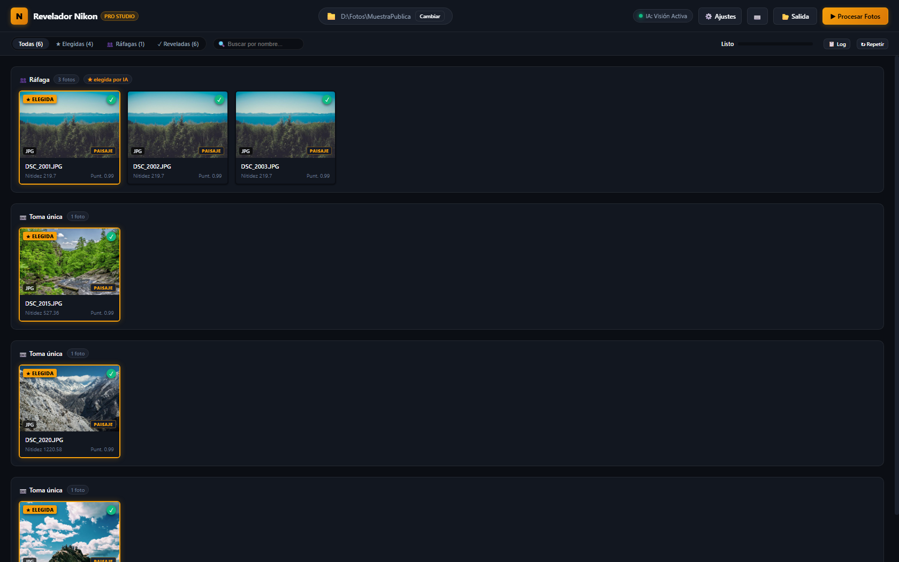
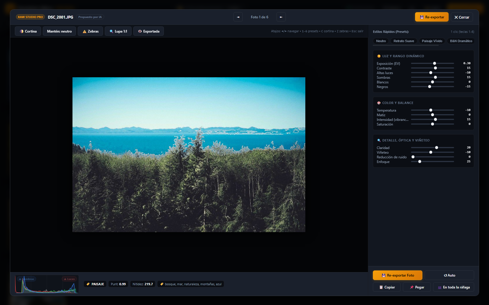

# ⚡ CullFlow — El Estudio Inteligente y Privado de Selección y Revelado RAW

<div align="center">

[](https://www.python.org/)
[](https://www.libraw.org/)
[](https://github.com/djbel63/CullFlow)
[](https://github.com/djbel63/CullFlow)
[](LICENSE)
[](#-soporte-bilingüe-instantáneo)

**La alternativa de código abierto y 100% privada a Adobe Lightroom y Photo Mechanic para cribar y revelar sesiones fotográficas masivas.**

[Español](README.es.md) • [English (README in English)](README.md)

</div>

---

<p align="center">
  
</p>

---

## 💡 ¿Por qué CullFlow?

Cualquier fotógrafo conoce el tedio de volver de una boda, un evento deportivo o unas vacaciones con **miles de archivos RAW**:
- Navegar entre cientos de fotos casi idénticas de una ráfaga es lento y agotador.
- Las herramientas basadas en la nube exigen subir gigabytes de fotos privadas a servidores de terceros.
- El software bajo suscripción te ata a cuotas mensuales y catálogos propietarios.

**CullFlow soluciona esto directamente en tu ordenador:**
1. **Agrupación Inteligente de Ráfagas**: Detecta automáticamente secuencias consecutivas y las organiza en grupos limpios.
2. **Puntuación de Nitidez y Expresión Facial**: Evalúa el enfoque exacto, ojos abiertos y sonrisas de forma local con OpenCV DNN.
3. **Asistencia Opcional con IA Visual Local**: Conéctalo a modelos locales (como *Qwen-VL*, *LLaVA* u *Ollama*) para elegir la mejor toma por composición artística y expresión emocional — **sin enviar ni un solo byte a internet**.
4. **Lupa 1:1 y Cortina Antes/Después en Tiempo Real**: Inspecciona la nitidez al 100% real de píxeles del sensor y compara el RAW original con tus ajustes sin retraso.
5. **Compatibilidad RAW Universal**: Revela Sony, Canon, Nikon, Fujifilm, Leica, Olympus, Panasonic y DNG con aceleración multinúcleo mediante LibRaw.
6. **No destructivo y Compatible con XMP**: Escribe metadatos estándar `.xmp` directamente legibles por Adobe Lightroom, Camera Raw y Darktable.

---

<p align="center">
  
</p>

---

## 📷 Compatibilidad Universal de Cámaras y RAW

Gracias al motor **LibRaw**, CullFlow soporta **más de 1.000 modelos de cámaras**:

| Marca | Extensiones | Modelos Comprobados | Emulación de Perfil de Color |
| :--- | :--- | :--- | :--- |
| **Sony** | `.arw`, `.srf`, `.sr2` | A7 IV, A7R V, A1, A9, A6700, ZV-E1 | Creative Look / Picture Profile |
| **Canon** | `.cr3`, `.cr2`, `.crw` | R5, R6, R3, 5D Mark IV, EOS R | Picture Style (Estándar, Fiel, Retrato) |
| **Nikon** | `.nef`, `.nrw` | Z9, Z8, Z6 III, Zf, D850, D750 | Picture Control (Auto, Estándar, Neutro) |
| **Fujifilm** | `.raf` (X-Trans y Bayer) | X-T5, X100VI, X-H2S, GFX 100 II | Film Simulation (Provia, Velvia, Classic Chrome) |
| **OM System / Olympus** | `.orf`, `.ori` | OM-1, E-M1 Mark III, OM-5 | Picture Mode (Natural, Vívido, Retrato) |
| **Panasonic Lumix** | `.rw2` | S5 II, GH6, G9 II, S1R | Photo Style (Estándar, Vívido, Natural) |
| **Leica** | `.dng`, `.rwl` | M11, SL2, Q3, D-Lux | Ciencia de color nativa Leica DNG |
| **DNG Universal** | `.dng` | Apple ProRAW (iPhone 14/15/16 Pro), Drones DJI, Pentax, Hasselblad | Perfiles estándar Adobe DNG |

---

## ⚡ Inicio en 1 Clic (Sin configuración técnica)

No necesitas configurar bases de datos ni dependencias complejas. Todo funciona con un único archivo:

### 🪟 Windows
1. Descarga o clona este repositorio.
2. Haz doble clic en **`CullFlow.bat`**.
   - *Primera vez*: Crea automáticamente el entorno virtual aislado e instala las librerías necesarias.
   - *Siguientes ejecuciones*: Arranca de inmediato en **~1 segundo** y abre tu navegador en `http://127.0.0.1:8765`.

### 🍎 macOS y 🐧 Linux
```bash
git clone https://github.com/djbel63/CullFlow.git cullflow
cd cullflow
chmod +x cullflow.sh
./cullflow.sh
```

---

## 🌟 Características Destacadas

### 1. 🎯 Cribado Inteligente de Ráfagas y Secuencias
- Las fotos tomadas en intervalos de pocos segundos se agrupan automáticamente.
- El algoritmo evalúa cada fotograma mediante **nitidez de alta frecuencia** (varianza laplaciana) y **análisis facial** (YuNet DNN).
- CullFlow destaca la foto más nítida donde todos los sujetos tienen los **ojos abiertos y sonríen**.

### 2. 🧠 Asistencia con IA Visual 100% Local y Privada
- Conéctalo a cualquier servidor local compatible con OpenAI (**Ollama**, **LM Studio**, **vLLM**) con modelos como `qwen2.5-vl` o `llama3.2-vision`.
- La IA examina las imágenes para valorar la expresión, microcontraste, composición y emoción.
- **Privacidad Total**: Procesado íntegramente en tu tarjeta gráfica local. Cero telemetría, cero tráfico hacia internet.

### 3. 🔍 Lupa 1:1 y Cortina Interactiva Antes / Después
- Pulsa `Z` o haz clic en **Lupa 1:1** para examinar los píxeles reales del sensor al 100% de resolución con cruceta sincronizada.
- Pulsa `C` para desplegar la **cortina deslizante antes / después** comparando el revelado original de cámara frente a tus ajustes.
- Histograma RGB en tiempo real con alertas de empastado de sombras y quemado de luces (zebras).

### 4. 🎨 Motor RAW de Grado Profesional y Ajustes No Destructivos
- Algoritmos de demosaicing de máxima calidad: **AAHD**, **AMaZE**, **DCB** y **VNG**.
- Control tonal completo: Exposición, Contraste, Luces, Sombras, Blancos, Negros, Saturación, Intensidad, Temperatura, Matiz, Nitidez, Reducción de Ruido y Viñeteo.
- Estilos rápidos en 1 clic: *Neutro*, *Retrato Suave*, *Paisaje Vívido*, *B&N Dramático*, *Hora Dorada* y *Noche Limpia*.
- Flujo por lotes: **Copiar Ajustes (`Ctrl+C`)** y **Aplicar a toda la ráfaga (`⚡`)** para editar secuencias enteras al instante.

### 5. 🌐 Soporte Bilingüe Instantáneo
- Selector directo de idioma (**Español ES** / **English EN**) en la barra superior.
- Memoriza tu preferencia automáticamente sin recargar la página.

---

## ⌨️ Atajos de Teclado Profesionales

| Tecla | Acción |
| :--- | :--- |
| `Espacio` | Abrir / Cerrar el Inspector RAW en pantalla completa |
| `←` / `→` | Foto anterior / siguiente |
| `P` | Marcar como **Elegida / Pick** (★) |
| `X` | Marcar como **Rechazada** |
| `U` | Quitar selección |
| `1` – `6` | Aplicar preset rápido (Neutro, Retrato, Paisaje, B&N, Dorada, Noche) |
| `C` | Alternar **Cortina Antes / Después** |
| `Z` | Alternar **Lupa 1:1 de sensor real** |
| `E` | Re-exportar foto con ajustes actuales |
| `Enter` | Iniciar revelado por lotes |
| `Esc` | Cerrar cualquier ventana o modal abierto |

---

## 🤖 Configuración Opcional de IA Visual Local

Para activar la evaluación mediante IA local, puedes ejecutar [Ollama](https://ollama.com/) o [LM Studio](https://lmstudio.ai/) en tu equipo:

```bash
# Ejemplo con Ollama:
ollama run qwen2.5-vl:7b
```

Luego en CullFlow:
1. Abre **⚙️ Ajustes**.
2. Ve a la pestaña **Inteligencia Artificial**.
3. Indica la URL del servidor API (ej: `http://localhost:11434/v1`) y el nombre del modelo (`qwen2.5-vl:7b`).
4. Haz clic en **🧪 Probar Conexión** y guarda los cambios.

---

## 🔒 Garantía de Privacidad

- **Cero Subidas a la Nube**: Todas tus fotos se procesan exclusivamente en tu ordenador.
- **Cero Telemetría**: Sin rastreadores, métricas ni perfiles de usuario.
- **Higiene de Archivos**: CullFlow nunca altera tus archivos RAW originales; las recetas se guardan en ficheros auxiliares `.xmp` o se exportan a la carpeta de salida que elijas.

---

## 📄 Licencia

Distribuido bajo la **Licencia MIT**. Consulta [LICENSE](LICENSE) para más información.
