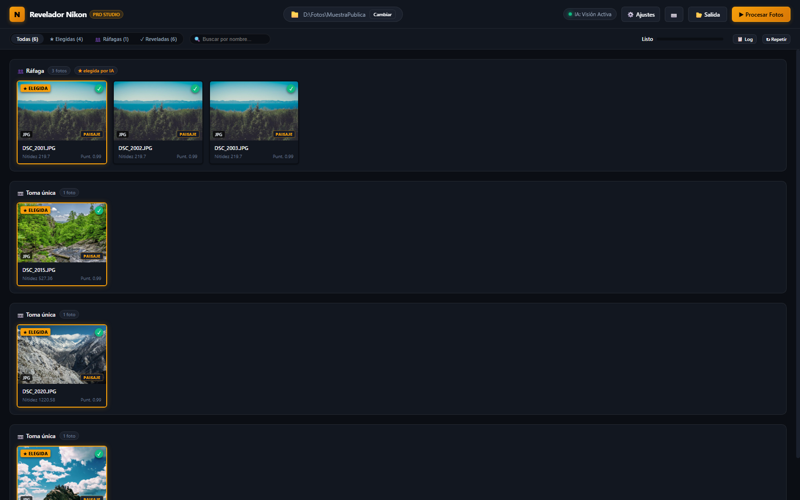
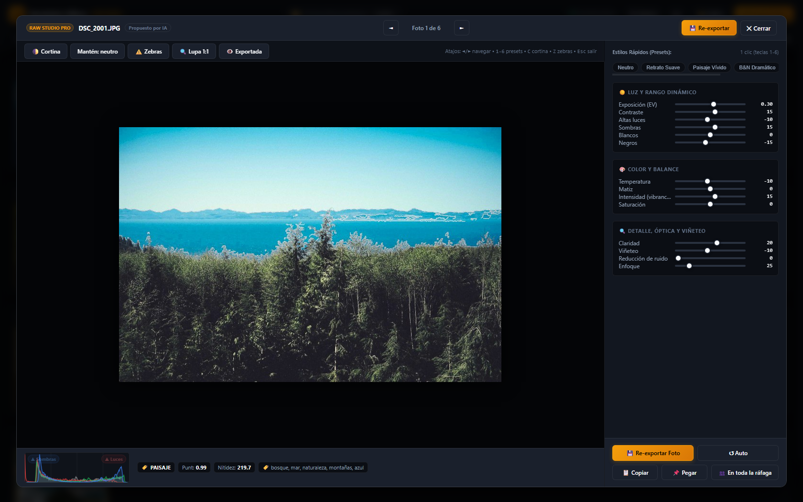

# ⚡ CullFlow — The Private, AI-Powered RAW Culling & Development Studio

<div align="center">

[](https://www.python.org/)
[](https://www.libraw.org/)
[](https://github.com/djbel63/CullFlow)
[](https://github.com/djbel63/CullFlow)
[](LICENSE)
[](#-multilingual-support)

**The open-source, private alternative to Adobe Lightroom & Photo Mechanic for culling and developing massive photo shoots.**

[English](README.md) • [Español (README en Español)](README.es.md)

</div>

---

<p align="center">
  
</p>

---

## 💡 Why CullFlow?

Every photographer knows the pain of returning from a wedding, sports event, or vacation with **thousands of RAW photos**:
- Scrolling through hundreds of burst frames is slow and exhausting.
- Cloud-based AI tools require uploading gigabytes of private photos over the internet.
- Subscription software locks your photos into proprietary databases.

**CullFlow solves this entirely on your machine:**
1. **Intelligent Burst Clustering**: Groups fast bursts into clean visual sequences automatically.
2. **Sharpness & Expression Scoring**: Evaluates focus, open eyes, and smiles locally using OpenCV DNN.
3. **Optional Private Vision AI**: Connects directly to local offline models (like *Qwen-VL*, *LLaVA*, or *Ollama*) to pick the best shot based on artistic composition and subject expression — **with 0 bytes ever sent to the cloud**.
4. **Instant 1:1 Loupe & Split Curtain**: Inspect sensor-level 100% pixel sharpness and compare raw vs. developed side-by-side with zero lag.
5. **Universal RAW Support**: Demosaics Sony, Canon, Nikon, Fujifilm, Leica, Olympus, Panasonic, and DNG with multi-threaded LibRaw acceleration.
6. **Non-Destructive & XMP Compatible**: Writes standard `.xmp` sidecar files directly readable by Adobe Lightroom, Camera Raw, and Darktable.

---

<p align="center">
  
</p>

---

## 📷 Universal Camera & RAW Support

CullFlow is powered by **LibRaw** and supports **over 1,000 camera models** out of the box:

| Brand | Extensions | Tested Models | Color Profile Emulation |
| :--- | :--- | :--- | :--- |
| **Sony** | `.arw`, `.srf`, `.sr2` | A7 IV, A7R V, A1, A9, A6700, ZV-E1 | Creative Look / Picture Profile |
| **Canon** | `.cr3`, `.cr2`, `.crw` | R5, R6, R3, 5D Mark IV, EOS R | Picture Style (Standard, Fine Detail, Portrait) |
| **Nikon** | `.nef`, `.nrw` | Z9, Z8, Z6 III, Zf, D850, D750 | Picture Control (Auto, Standard, Neutral) |
| **Fujifilm** | `.raf` (X-Trans & Bayer) | X-T5, X100VI, X-H2S, GFX 100 II | Film Simulation (Provia, Velvia, Classic Chrome) |
| **OM System / Olympus** | `.orf`, `.ori` | OM-1, E-M1 Mark III, OM-5 | Picture Mode (Natural, Vivid, Portrait) |
| **Panasonic Lumix** | `.rw2` | S5 II, GH6, G9 II, S1R | Photo Style (Standard, Vivid, Natural) |
| **Leica** | `.dng`, `.rwl` | M11, SL2, Q3, D-Lux | Native Leica DNG color science |
| **Universal DNG** | `.dng` | Apple ProRAW (iPhone 14/15/16 Pro), DJI Drones, Pentax, Hasselblad | Standard Adobe DNG Profiles |

---

## ⚡ 1-Click Launch (Zero Technical Setup)

No need to configure databases, servers, or environment variables. Everything runs from a single launcher:

### 🪟 Windows
1. Download or clone this repository.
2. Double-click **`CullFlow.bat`**.
   - *First run*: Automatically creates the isolated virtual environment and installs required libraries.
   - *Subsequent runs*: Launches the studio instantly in **~1 second** and opens your default browser at `http://127.0.0.1:8765`.

### 🍎 macOS & 🐧 Linux
```bash
git clone https://github.com/djbel63/CullFlow.git cullflow
cd cullflow
chmod +x cullflow.sh
./cullflow.sh
```

---

## 🌟 Key Features

### 1. 🎯 Intelligent Burst & Sequence Culling
- Sequences shot within seconds of each other are automatically grouped into tidy cards.
- The algorithm scores every frame for **high-frequency sharpness** (Laplacian variance) and **facial features** (YuNet DNN).
- CullFlow automatically selects the sharpest frame where everyone has their **eyes open and is smiling**.

### 2. 🧠 100% Offline Vision AI Assistance
- Connect to any local OpenAI-compatible endpoint (such as **Ollama**, **LM Studio**, or **vLLM**) running vision models like `qwen2.5-vl` or `llama3.2-vision`.
- The AI inspects the images to evaluate expression, micro-contrast, composition, and mood.
- **Strict Privacy**: Processed entirely on your local GPU. Zero telemetry, zero external network traffic.

### 3. 🔍 Real-Time 1:1 Loupe & Interactive Split Curtain
- Press `Z` or click **Lupa 1:1** to inspect actual sensor pixels at 100% resolution with a synchronized crosshair.
- Press `C` to reveal the **interactive before/after split curtain** comparing the camera raw rendering vs. your adjustments.
- Real-time WebGL RGB histogram with shadow/highlight clipping zebra warnings.

### 4. 🎨 Studio-Grade RAW Engine & Non-Destructive Presets
- High-quality demosaicing: **AAHD**, **AMaZE**, **DCB**, and **VNG**.
- Full exposure and tone curve: Exposure, Contrast, Highlights, Shadows, Whites, Blacks, Saturation, Vibrance, Temperature, Tint, Sharpness, Noise Reduction, and Vignette.
- 1-click presets: *Neutral*, *Soft Portrait*, *Vivid Landscape*, *Dramatic B&W*, *Golden Hour*, and *Clean Night*.
- Batch workflow: **Copy Recipe (`Ctrl+C`)** and **Apply to Entire Burst (`⚡`)** to grade an entire sequence in a single click.

### 5. 🌐 Instant Multilingual Support
- Built-in instant toggle between **English (EN)** and **Spanish (ES)** in the top navigation bar.
- Remembers your language preference automatically without page reloads.

---

## ⌨️ Professional Keyboard Shortcuts

Speed up your culling by keeping your hands on the keyboard:

| Key | Action |
| :--- | :--- |
| `Space` | Open / Close Fullscreen RAW Inspector |
| `←` / `→` | Previous / Next photo |
| `P` | Mark as **Selected / Pick** (★) |
| `X` | Mark as **Rejected** |
| `U` | Clear mark |
| `1` – `6` | Apply quick presets (Neutral, Portrait, Landscape, B&W, Golden, Night) |
| `C` | Toggle **Before / After Split Curtain** |
| `Z` | Toggle **1:1 Real Sensor Loupe** |
| `E` | Re-export current photo with adjustments |
| `Enter` | Start batch development |
| `Esc` | Close any open modal or inspector |

---

## 🤖 Optional Local Vision AI Setup

To enable local AI evaluation, you can run [Ollama](https://ollama.com/) or [LM Studio](https://lmstudio.ai/) on your machine:

```bash
# Example with Ollama:
ollama run qwen2.5-vl:7b
```

Then in CullFlow:
1. Open **⚙️ Settings** (`Ajustes`).
2. Go to the **Inteligencia Artificial / Local Vision AI** tab.
3. Set the API URL (e.g. `http://localhost:11434/v1` for Ollama) and model name (`qwen2.5-vl:7b`).
4. Click **🧪 Test Connection** and save!

---

## 🔒 Privacy Guarantee

- **Zero Cloud Uploads**: Your photos are processed exclusively inside your local machine.
- **Zero Telemetry**: No tracking, analytics, or user profiling.
- **Clean File Hygiene**: CullFlow never modifies your original RAW files; adjustments are written to independent `.xmp` sidecars or exported to your designated output directory.

---

## 📄 License

Distributed under the **MIT License**. See [LICENSE](LICENSE) for more details.

---

<div align="center">
  <sub>Crafted for photographers who value speed, precision, and privacy.</sub>
</div>
